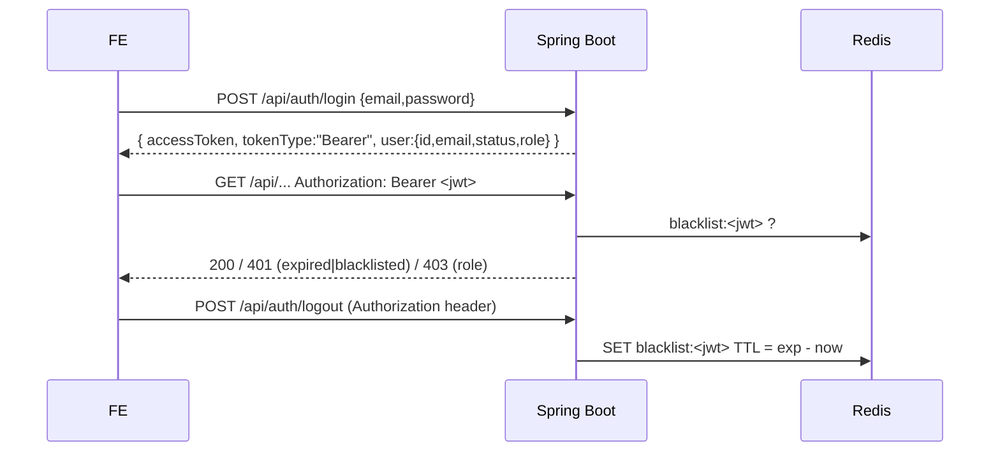
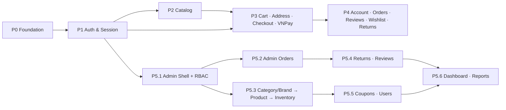

# Frontend Master Implementation Plan — Electronics E-commerce

> Nguồn: khảo sát toàn bộ `ecommerce-backend` (Spring Boot **4.1.1**, Java 21, Jackson 3, OAuth2 Resource Server JWT, Redis, MySQL, VNPay, springdoc-openapi).
> 16 module nghiệp vụ · 22 controller · ~75 endpoint.

---

## 0. TL;DR — Những phát hiện quan trọng nhất

| # | Phát hiện | Tác động lên FE |
|---|---|---|
| 1 | **Không có refresh token**. Access token HS256, sống **24h**, logout = blacklist trên Redis | Interceptor "auto refresh 401" phải thiết kế dạng *pluggable*; hiện tại 401 ⇒ logout + redirect |
| 2 | **Mọi ID là TSID 64-bit** (vượt `Number.MAX_SAFE_INTEGER`) | Bắt buộc `type ID = string` toàn bộ FE. Backend đã format đầy đủ `@JsonFormat(STRING)` cho các DTO (kể cả `AdminReviewResponse.id` và `OrderDetailAdminResponse.userId`) |
| 3 | **Không có CORS config** trong `SecurityConfig` | Dev: dùng Vite proxy. Prod: cần reverse proxy cùng origin hoặc thêm CORS |
| 4 | Endpoint `permitAll` **vẫn trả 401** nếu gửi Bearer token hết hạn/bị blacklist | Interceptor phải retry request public *không kèm token* |
| 5 | VNPay `return-url = http://localhost:3000/payment/result` | Vite dev server chạy **port 3000**; FE có route `/payment/result` |
| 6 | **Link email verify/reset** trỏ sang Frontend | Backend đã cấu hình `app.frontend-url` (port 3000), link trỏ đúng tới FE `/verify-email` và `/reset-password` |
| 7 | Guest checkout bắt buộc gửi `directItems` (server cart chỉ dành cho user) | FE phải có **guest cart local** (Zustand persist) + merge khi login |
| 8 | Lỗi chuẩn hóa `ErrorResponse { status, error, message, validationErrors? }` | Map `validationErrors` thẳng vào React Hook Form |

Danh sách đầy đủ gap backend: xem [Mục 7](#7-backend-gaps--blockers-cần-phối-hợp).

---

## 1. Khảo sát & Tổng hợp API Contract

### 1.1 Danh sách module nghiệp vụ

| Module | Controller (Customer / Public) | Controller (Admin) | Phase FE |
|---|---|---|---|
| **auth** | `AuthController` `/api/auth`, `UserController` `/api/users` | `AdminUserController` `/api/admin/users` | P1 / P4 / P5 |
| **category** | `CategoryController` `/api/categories` | `AdminCategoryController` | P2 / P5 |
| **brand** | `BrandController` `/api/brands` | `AdminBrandController` (multipart) | P2 / P5 |
| **product** | `ProductController` `/api/products` | `AdminProductController` (multipart) | P2 / P5 |
| **policy** | `PolicyController` `/api/policies/{slug}` | — | P2 |
| **cart** | `CartController` `/api/cart` | — | P3 |
| **address** | `AddressController` `/api/addresses` | — | P3 |
| **order** | `OrderController` `/api/orders` (checkout public) | `AdminOrderController` | P3 / P4 / P5 |
| **payment** | `PaymentController` `/api/payments/vnpay` | — | P3 |
| **review** | `ReviewController` `/api/reviews` | `AdminReviewController` | P4 / P5 |
| **wishlist** | `WishlistController` `/api/wishlists` | — | P4 |
| **returnrequest** | `ReturnRequestController` (multipart) | `AdminReturnRequestController` | P4 / P5 |
| **inventory** | — | `AdminInventoryController` | P5 |
| **coupon** | — (áp dụng qua checkout) | `AdminCouponController` | P3 / P5 |
| **dashboard** | — | `AdminDashboardController` | P5 |
| **report** | — | `AdminReportController` (CSV export) | P5 |

### 1.2 Authentication & Authorization



| Khía cạnh | Chi tiết backend |
|---|---|
| Token | JWT HS256, `iss=ecommerce-backend`, `sub=userId`, claims `email`, `role` (`ADMIN\|MANAGER\|STAFF\|CUSTOMER`), `exp = iat + 24h` |
| Refresh | ❌ Không có endpoint refresh |
| Logout | `POST /api/auth/logout` — đưa token vào blacklist Redis |
| Session | Stateless, CSRF disabled ⇒ lưu token phía client |
| Public routes | `/api/products/**`, `/api/categories/**`, `/api/brands/**`, `/api/policies/**`, `/api/auth/**`, `/api/orders/checkout`, `/api/payments/vnpay/**`, `/uploads/**` |
| RBAC | Prefix `ROLE_` từ claim `role`; `@PreAuthorize` ở class + override ở method |
| User status | `PENDING` (chưa verify, không login được) → `ACTIVE` → `INACTIVE` (bị khóa) |

#### Ma trận phân quyền (trích từ `@PreAuthorize`)

| Tài nguyên / hành động | ADMIN | MANAGER | STAFF |
|---|:-:|:-:|:-:|
| Dashboard, Reports | ✅ | ✅ | ❌ |
| Users: list / detail / lock-unlock | ✅ | ✅ *(chỉ Customer)* | ❌ |
| Users: đổi role | ✅ | ❌ | ❌ |
| Categories, Brands: CUD | ✅ | ✅ | ❌ |
| Products: create / update | ✅ | ✅ | ✅ |
| Products: đổi status | ✅ | ✅ | ❌ |
| Inventory: xem / điều chỉnh / lịch sử | ✅ | ✅ | ✅ |
| Orders: list / detail / update status | ✅ | ✅ | ✅ |
| Orders: cancel (có lý do) | ✅ | ✅ | ❌ |
| Coupons: xem | ✅ | ✅ | ✅ |
| Coupons: create / update / toggle | ✅ | ✅ | ❌ |
| Return requests: xem | ✅ | ✅ | ✅ |
| Return requests: xử lý | ✅ | ✅ | ❌ |
| Reviews: xem / reply | ✅ | ✅ | ✅ |
| Reviews: ẩn/hiện | ✅ | ✅ | ❌ |

### 1.3 Quy ước dữ liệu xuyên suốt

| Java type | JSON | TypeScript |
|---|---|---|
| `Long id` + `@JsonFormat(STRING)` | `"7193847261029384"` | `ID = string` |
| `BigDecimal` | `30000` (number) | `Money = number` (VND, không có phần thập phân) |
| `Instant` | `"2026-10-12T02:12:42Z"` | `ISODateTime = string` |
| `LocalDate` (query param / response) | `"2026-10-12"` | `ISODate = string` |
| `Map<String,Object>` (attributes/specification) | object | `Record<string, string \| number \| boolean>` |
| `boolean isXxx` (primitive, Lombok) | **`"xxx"`** (mất tiền tố `is`) | xem ghi chú dưới |
| `Boolean isXxx` (wrapper) | `"isXxx"` | giữ nguyên |
| `Page<T>` | Spring Data Page | normalize về `Page<T>` riêng |

> [!WARNING]
> Lombok sinh getter `isActive()` cho `boolean isActive` ⇒ Jackson serialize thành **`active`**. Áp dụng cho: `CouponResponse.isActive → active`, `AdminReviewResponse.isHidden → hidden`, `ReviewResponse.isProductDeleted → productDeleted`, `WishlistItemResponse.inStock → inStock`. **Xác minh lại bằng Swagger UI** (`/swagger-ui/index.html`) trước khi chốt type.

### 1.4 Error contract

```jsonc
// 400 / 403 / 404 / 409 / 500 — từ GlobalExceptionHandler
{
  "timestamp": "2026-10-12T02:12:42Z",
  "status": 400,
  "error": "Validation Failed",          // "Bad Request" | "Not Found" | "Conflict" | "Forbidden" | ...
  "message": "Invalid request payload",
  "validationErrors": { "phone": "Invalid phone number format." }   // chỉ có khi @Valid fail
}
```

| HTTP | Nguồn | Body |
|---|---|---|
| 400 | `BadRequestException`, `@Valid` | `ErrorResponse` |
| 401 | Spring Security filter (token thiếu/hết hạn/blacklist) | **Rỗng** + header `WWW-Authenticate` |
| 403 | `@PreAuthorize`/`AccessDeniedException` trong service | `ErrorResponse` |
| 404 | `ResourceNotFoundException` | `ErrorResponse` *(lưu ý: login sai email trả **404**)* |
| 409 | `DuplicateResourceException` | `ErrorResponse` |
| 500 | Exception khác | `ErrorResponse` (message chung) |

Một số endpoint trả **plain text** thay vì JSON (`String`): `PUT /admin/users/{id}/status|role`, `POST /users/change-password`, `POST|PUT /admin/products`, `PATCH /admin/products/{id}/status`, `PUT /admin/coupons/{id}/toggle-status`.

---

## 2. Kiến trúc nền tảng (Foundation & Core Setup)

### 2.1 Tech stack đề xuất

| Hạng mục | Lựa chọn | Lý do |
|---|---|---|
| Build | **Vite 6 + React 19 + TypeScript 5 (strict)** | Theo yêu cầu |
| Routing | **React Router v7** (library/data mode, `createBrowserRouter`) | Lazy routes, loader guard, nested layout cho 2 phân hệ |
| Server state | **TanStack Query v5** | Cache, invalidation, optimistic update, pagination `placeholderData` |
| HTTP | **Axios** | Interceptor (token, 401, error normalize), `responseType: 'blob'` cho export |
| Client state | **Zustand** (+ `persist`) | Session, guest cart, compare list, UI prefs — nhẹ hơn Redux, đủ cho quy mô này |
| Form | **React Hook Form + Zod** (`@hookform/resolvers`) | Mirror Bean Validation; map `validationErrors` → `setError` |
| UI | **Tailwind CSS v4 + shadcn/ui** (Radix) | Storefront cần tùy biến thẩm mỹ cao; admin tái dùng cùng design tokens |
| Table (admin) | **TanStack Table v8** | Server-side pagination/sort |
| Chart | **Recharts** | Revenue line chart, order-status pie |
| Date | **date-fns** + `date-fns-tz` | Hiển thị `Asia/Ho_Chi_Minh`, format `yyyy-MM-dd` cho query |
| Rich text | `react-markdown` / sanitize HTML (`dompurify`) | Policy content, product description |
| Toast | `sonner` | Đi kèm shadcn |
| Type-gen | **`openapi-typescript`** từ `/v3/api-docs` | Đối chiếu tự động với DTO, giảm drift |
| Test | Vitest + Testing Library + **MSW** | Mock API theo contract |
| Lint | ESLint flat + Prettier + `eslint-plugin-boundaries` | Chặn import chéo giữa features |

> [!NOTE]
> Template Vite mới bật `erasableSyntaxOnly` ⇒ **không dùng TS `enum`**; dùng `as const` object + union type.

**Một app, hai layout**: `StorefrontLayout` và `AdminLayout` (lazy chunk `/admin/*`). Dùng chung API client, types, design tokens; bundle admin không tải cho khách.

### 2.2 Cấu trúc thư mục (feature-based)

```
src/
├── app/
│   ├── main.tsx
│   ├── providers.tsx              # QueryClientProvider, Toaster, ThemeProvider
│   ├── router.tsx                 # createBrowserRouter: storefront + admin trees
│   └── layouts/
│       ├── StorefrontLayout.tsx   # Header (search, cart badge, user menu), Footer
│       ├── AccountLayout.tsx      # Sidebar tài khoản
│       └── AdminLayout.tsx        # Sidebar theo quyền, Topbar
├── shared/
│   ├── api/
│   │   ├── client.ts              # axios instance + interceptors
│   │   ├── errors.ts              # ApiError, normalizeError
│   │   ├── pagination.ts          # normalizePage()
│   │   ├── download.ts            # blob download + Content-Disposition
│   │   └── queryClient.ts
│   ├── auth/
│   │   ├── session.store.ts       # Zustand: token, user, role
│   │   ├── jwt.ts                 # decode, isExpired
│   │   ├── permissions.ts         # ma trận RBAC
│   │   └── guards.tsx             # RequireAuth, RequireRole, GuestOnly
│   ├── types/                     # common.ts, enums.ts, (generated) openapi.d.ts
│   ├── ui/                        # shadcn components + Money, StatusBadge, DataTable, EmptyState
│   ├── hooks/                     # useDebounce, usePagination(searchParams), useConfirm
│   ├── lib/                       # format.ts (VND, date), cn.ts
│   └── config/env.ts
├── features/
│   ├── auth/        { api.ts, queries.ts, schemas.ts, types.ts, components/, pages/ }
│   ├── catalog/     (product, category, brand, compare, search-suggest)
│   ├── policy/
│   ├── cart/        (server cart + guest cart store + merge)
│   ├── checkout/    (checkout + payment result)
│   ├── address/
│   ├── orders/      (customer orders)
│   ├── reviews/
│   ├── wishlist/
│   ├── returns/
│   └── admin/
│       ├── dashboard/  orders/  products/  categories/  brands/
│       ├── inventory/  coupons/  reviews/  returns/  users/  reports/
└── styles/index.css               # Tailwind v4 @theme tokens
```

Quy tắc: `features/*` chỉ import từ `shared/*` và public `index.ts` của feature khác; `shared/*` không import `features/*`.

### 2.3 Env & Vite config

```ts
// .env.development
VITE_API_BASE_URL=            # rỗng ⇒ dùng proxy cùng origin
VITE_BACKEND_ORIGIN=http://localhost:8080
```

```ts
// vite.config.ts
export default defineConfig({
  plugins: [react(), tailwindcss()],
  resolve: { alias: { '@': '/src' } },
  server: {
    port: 3000,                 // khớp vnpay.return-url
    strictPort: true,
    proxy: {
      '/api':     { target: 'http://localhost:8080', changeOrigin: true },
      '/uploads': { target: 'http://localhost:8080', changeOrigin: true },
    },
  },
});
```

### 2.4 Base API Client

```ts
// shared/api/errors.ts
export interface ApiErrorBody {
  timestamp?: string; status: number; error?: string; message?: string;
  validationErrors?: Record<string, string>;
}

export class ApiError extends Error {
  constructor(
    public status: number,
    message: string,
    public code?: string,                         // body.error
    public fieldErrors?: Record<string, string>,  // body.validationErrors
  ) { super(message); }
  get isValidation() { return !!this.fieldErrors && Object.keys(this.fieldErrors).length > 0; }
}

export async function normalizeError(err: unknown): Promise<ApiError> {
  if (!axios.isAxiosError(err)) return new ApiError(0, 'Unexpected error');
  if (!err.response) return new ApiError(0, 'Không thể kết nối máy chủ. Vui lòng thử lại.');
  const { status } = err.response;
  let data: unknown = err.response.data;
  if (data instanceof Blob) {                       // export CSV lỗi → body JSON nằm trong Blob
    try { data = JSON.parse(await data.text()); } catch { data = undefined; }
  }
  const body = (typeof data === 'object' && data) ? (data as ApiErrorBody) : undefined;
  const fallback: Record<number, string> = {
    401: 'Phiên đăng nhập đã hết hạn.', 403: 'Bạn không có quyền thực hiện thao tác này.',
    404: 'Không tìm thấy dữ liệu.', 500: 'Đã có lỗi xảy ra. Vui lòng thử lại sau.',
  };
  return new ApiError(status, body?.message || (typeof data === 'string' && data) || fallback[status] || 'Request failed',
    body?.error, body?.validationErrors);
}
```

```ts
// shared/api/client.ts
export const api = axios.create({ baseURL: env.API_BASE_URL, timeout: 20_000 });

// 1) Gắn token (bỏ qua nếu token đã hết hạn theo claim exp)
api.interceptors.request.use((config) => {
  const { token } = useSession.getState();
  if (token && !isExpired(token) && !config.headers['X-Skip-Auth']) {
    config.headers.Authorization = `Bearer ${token}`;
  }
  delete config.headers['X-Skip-Auth'];
  return config;
});

// 2) Xử lý 401 + chuẩn hóa lỗi
let refreshPromise: Promise<string | null> | null = null;

/** Hiện backend KHÔNG có refresh endpoint ⇒ trả null. Khi BE bổ sung
 *  POST /api/auth/refresh (httpOnly cookie), chỉ cần implement hàm này. */
async function refreshAccessToken(): Promise<string | null> { return null; }

api.interceptors.response.use(
  (res) => res,
  async (error) => {
    const original = error.config as InternalAxiosRequestConfig & { _retry?: boolean; _public?: boolean };
    const status = error.response?.status;

    if (status === 401 && original && !original._retry) {
      original._retry = true;

      // a) Thử refresh (single-flight: các request 401 đồng thời chờ chung 1 promise)
      refreshPromise ??= refreshAccessToken().finally(() => { refreshPromise = null; });
      const newToken = await refreshPromise;
      if (newToken) {
        useSession.getState().setToken(newToken);
        original.headers.Authorization = `Bearer ${newToken}`;
        return api(original);
      }

      // b) Không refresh được ⇒ xóa session
      const hadToken = !!original.headers.Authorization;
      useSession.getState().clear({ reason: 'expired' });

      // c) Endpoint public bị 401 chỉ vì token cũ ⇒ retry KHÔNG kèm token
      if (hadToken && isPublicEndpoint(original)) {
        delete original.headers.Authorization;
        original.headers['X-Skip-Auth'] = '1';
        return api(original);
      }
      // d) Protected ⇒ AuthEvents phát 'session-expired' → router redirect /login?redirect=...
      authEvents.emit('session-expired');
    }
    return Promise.reject(await normalizeError(error));
  },
);

const PUBLIC_PREFIXES = ['/api/products', '/api/categories', '/api/brands', '/api/policies',
  '/api/auth', '/api/orders/checkout', '/api/payments/vnpay'];
const isPublicEndpoint = (c: InternalAxiosRequestConfig) =>
  PUBLIC_PREFIXES.some((p) => (c.url ?? '').startsWith(p));
```

```ts
// shared/api/pagination.ts — chịu được cả 2 kiểu serialize Page của Spring Data
export interface Page<T> { content: T[]; page: number; size: number; totalElements: number; totalPages: number }
export function normalizePage<T>(raw: any): Page<T> {
  if (raw?.page && typeof raw.page === 'object') {             // VIA_DTO: { content, page:{...} }
    const { number, size, totalElements, totalPages } = raw.page;
    return { content: raw.content, page: number, size, totalElements, totalPages };
  }
  return { content: raw.content, page: raw.number, size: raw.size,  // DIRECT: PageImpl
           totalElements: raw.totalElements, totalPages: raw.totalPages };
}
```

```ts
// shared/api/download.ts
export async function downloadBlob(url: string, params: object, fallbackName: string) {
  const res = await api.get<Blob>(url, { params, responseType: 'blob' });
  const cd = res.headers['content-disposition'] ?? '';
  const name = decodeURIComponent(/filename\*=UTF-8''([^;]+)/i.exec(cd)?.[1]
             ?? /filename="?([^";]+)"?/i.exec(cd)?.[1] ?? fallbackName);
  const href = URL.createObjectURL(res.data);
  Object.assign(document.createElement('a'), { href, download: name }).click();
  URL.revokeObjectURL(href);
}
```

```ts
// shared/api/queryClient.ts
export const queryClient = new QueryClient({
  defaultOptions: {
    queries: {
      staleTime: 30_000,
      retry: (count, err) => !(err instanceof ApiError && [400, 401, 403, 404].includes(err.status)) && count < 2,
      refetchOnWindowFocus: false,
    },
    mutations: { onError: (err) => toast.error((err as ApiError).message) },  // override per-mutation khi cần
  },
});
```

**Helper form**: `applyServerErrors(form, apiError)` → lặp `fieldErrors` gọi `form.setError(field, { message })`; nếu không có field thì hiển thị `message` ở `<FormAlert/>`.

### 2.5 Session store & Guards

```ts
// shared/auth/session.store.ts
interface SessionState {
  token: string | null;
  user: { id: ID; email: string; role: Role; status: UserStatus } | null;
  setSession(token: string, user?: SessionState['user']): void;  // nếu thiếu user → decode JWT (sub, email, role)
  setToken(token: string): void;
  clear(opts?: { reason?: 'logout' | 'expired' }): void;          // + queryClient.clear()
}
// persist → localStorage key 'ec.session'; lắng nghe 'storage' event để đồng bộ logout giữa các tab.
// Timer: setTimeout tới exp − 60s → toast "Phiên sắp hết hạn" → clear() khi tới exp.
```

```tsx
// shared/auth/guards.tsx
<RequireAuth />                       // chưa login → /login?redirect=<current>
<RequireRole roles={['ADMIN','MANAGER','STAFF']} />   // sai role → /403
<GuestOnly />                         // đã login → redirect về trang trước / theo role
```

```ts
// shared/auth/permissions.ts
export const PERMISSIONS = {
  'dashboard.view':        ['ADMIN', 'MANAGER'],
  'report.view':           ['ADMIN', 'MANAGER'],
  'user.view':             ['ADMIN', 'MANAGER'],
  'user.changeRole':       ['ADMIN'],
  'category.manage':       ['ADMIN', 'MANAGER'],
  'brand.manage':          ['ADMIN', 'MANAGER'],
  'product.write':         ['ADMIN', 'MANAGER', 'STAFF'],
  'product.changeStatus':  ['ADMIN', 'MANAGER'],
  'inventory.manage':      ['ADMIN', 'MANAGER', 'STAFF'],
  'order.view':            ['ADMIN', 'MANAGER', 'STAFF'],
  'order.updateStatus':    ['ADMIN', 'MANAGER', 'STAFF'],
  'order.cancel':          ['ADMIN', 'MANAGER'],
  'coupon.view':           ['ADMIN', 'MANAGER', 'STAFF'],
  'coupon.manage':         ['ADMIN', 'MANAGER'],
  'return.view':           ['ADMIN', 'MANAGER', 'STAFF'],
  'return.process':        ['ADMIN', 'MANAGER'],
  'review.view':           ['ADMIN', 'MANAGER', 'STAFF'],
  'review.reply':          ['ADMIN', 'MANAGER', 'STAFF'],
  'review.toggle':         ['ADMIN', 'MANAGER'],
} as const satisfies Record<string, readonly Role[]>;
export const useCan = (p: keyof typeof PERMISSIONS) => PERMISSIONS[p].includes(useSession((s) => s.user?.role)!);
// <Can perm="order.cancel">…</Can> dùng để ẩn nút; route dùng RequireRole tương ứng.
```

### 2.6 Shared types & enums

```ts
// shared/types/common.ts
export type ID = string;
export type ISODateTime = string;
export type ISODate = string;
export type Money = number;
export type Attributes = Record<string, string | number | boolean>;
export interface MessageResponse { message: string }
export interface PageParams { page?: number; size?: number }

// shared/types/enums.ts
const e = <T extends string>(...v: T[]) => Object.fromEntries(v.map((x) => [x, x])) as { [K in T]: K };
export const Role = e('ADMIN', 'MANAGER', 'STAFF', 'CUSTOMER');                    export type Role = keyof typeof Role;
export const UserStatus = e('PENDING', 'ACTIVE', 'INACTIVE');                       export type UserStatus = keyof typeof UserStatus;
export const ActiveStatus = e('ACTIVE', 'INACTIVE'); /* Brand/Category/Policy */    export type ActiveStatus = keyof typeof ActiveStatus;
export const ProductStatus = e('ACTIVE', 'INACTIVE', 'HIDDEN');                     export type ProductStatus = keyof typeof ProductStatus;
export const InventoryStatus = e('IN_STOCK', 'LOW_STOCK', 'OUT_OF_STOCK');          export type InventoryStatus = keyof typeof InventoryStatus;
export const InventoryAction = e('ADD', 'DEDUCT');                                  export type InventoryAction = keyof typeof InventoryAction;
export const OrderStatus = e('PENDING', 'PROCESSING', 'SHIPPED', 'DELIVERED', 'CANCELLED',
                             'RETURN_REQUESTED', 'RETURNED', 'RETURN_REJECTED');    export type OrderStatus = keyof typeof OrderStatus;
export const PaymentStatus = e('UNPAID', 'PAID', 'PENDING_REFUND', 'REFUNDED');     export type PaymentStatus = keyof typeof PaymentStatus;
export const PaymentMethod = e('COD', 'VNPAY');                                     export type PaymentMethod = keyof typeof PaymentMethod;
export const DiscountType = e('PERCENTAGE', 'FIXED_AMOUNT');                        export type DiscountType = keyof typeof DiscountType;
export const ReturnStatus = e('PENDING', 'APPROVED', 'REJECTED');                   export type ReturnStatus = keyof typeof ReturnStatus;
export const PolicyType = e('SHIPPING', 'PAYMENT', 'RETURN');                       export type PolicyType = keyof typeof PolicyType;

// Mirror OrderStatus.canTransitionTo() của backend
export const ORDER_TRANSITIONS: Record<OrderStatus, OrderStatus[]> = {
  PENDING: ['PROCESSING', 'CANCELLED'], PROCESSING: ['SHIPPED', 'CANCELLED'], SHIPPED: ['DELIVERED'],
  DELIVERED: ['RETURN_REQUESTED'], RETURN_REQUESTED: ['RETURNED', 'RETURN_REJECTED'],
  CANCELLED: [], RETURNED: [], RETURN_REJECTED: [],
};
```

Kèm `shared/ui/StatusBadge` với map label tiếng Việt + màu cho từng enum.

### 2.7 Query key factory

```ts
export const qk = {
  me:          ['me'] as const,
  categories:  (kw?: string) => ['categories', { kw }] as const,
  brands:      (kw?: string) => ['brands', { kw }] as const,
  products:    { list: (p: object) => ['products', 'list', p] as const, detail: (id: ID) => ['products', id] as const,
                 suggest: (q: string) => ['products', 'suggest', q] as const, compare: (ids: ID[]) => ['products', 'compare', ids] as const },
  cart:        ['cart'] as const,
  addresses:   ['addresses'] as const,
  orders:      { list: (p: object) => ['orders', 'list', p] as const, detail: (id: ID) => ['orders', id] as const },
  wishlist:    ['wishlist'] as const,
  reviews:     { pending: ['reviews', 'pending'] as const, history: ['reviews', 'history'] as const },
  admin: { /* dashboard, orders, users, inventory, coupons, reviews, returns, reports … tương tự */ },
};
```

---

## 3. Lộ trình triển khai (Roadmap) & Dependency Rationale



| Phase | Nội dung | Phụ thuộc & lý do | Ước lượng |
|---|---|---|---|
| **P0** | Scaffold, design tokens, layouts, API client, error/page normalize, QueryClient, shared UI (DataTable, Money, StatusBadge, ConfirmDialog, ImageUpload), MSW, type-gen | Mọi module dùng chung client/types/UI. Làm sai ở đây (ví dụ ID kiểu `number`) sẽ phải sửa toàn bộ về sau | 3–4 ngày |
| **P1** | Login, Register, Verify email, Resend, Forgot/Reset password, Logout, session store, guards, header user menu, `GET /users/me` | Cart, Address, Orders, Wishlist, Reviews, Returns và toàn bộ Admin đều **yêu cầu JWT**. Thêm nữa: quirk "public endpoint 401 khi token hết hạn" khiến **ngay cả Catalog** cũng cần interceptor auth hoàn chỉnh | 3 ngày |
| **P2** | Home, Product listing/search, Suggest, PDP + chọn variant, Compare, Category/Brand nav, Policy pages | Public, nhưng cung cấp **`productVariantId`** — đầu vào bắt buộc của Cart/Checkout. Category/Brand là dữ liệu tham chiếu cho cả filter lẫn admin form | 4–5 ngày |
| **P3** | Server cart + guest cart + merge, Address book, Checkout (user & guest, Buy Now), coupon, VNPay redirect + result page, Order success | Cần variant (P2) + auth (P1). **Address được kéo vào P3** (thay vì P4) vì checkout của user dùng `addressId` | 5–6 ngày |
| **P4** | Profile, Change password, Order history/detail/cancel/pay again/buy again, Reviews (pending/history/CRUD), Wishlist, Return request | Cần đơn hàng thật từ P3. Review & Return chỉ áp dụng cho đơn **DELIVERED** ⇒ trong lúc chưa có Admin Orders, dùng **Swagger UI** đẩy trạng thái đơn (hoặc kéo P5.2 lên song song) | 4–5 ngày |
| **P5** | Admin portal (thứ tự bên dưới) | Khung admin chỉ cần P1 (role) — có thể chạy **song song** với P2–P4 nếu có 2 dev | 8–10 ngày |

**Thứ tự nội bộ P5 & lý do:**

1. **Admin shell + RBAC sidebar** — mọi trang admin dựa vào nó.
2. **Orders** — giá trị vận hành cao nhất; mở khóa test P4 (DELIVERED → review/return).
3. **Category → Brand → Product → Inventory** — Product form cần `categoryId/brandId`; Inventory cần variant đã tồn tại.
4. **Return requests → Reviews** — phát sinh từ đơn hàng đã giao.
5. **Coupons → Users** — độc lập, CRUD đơn giản.
6. **Dashboard → Reports** — chỉ đọc số liệu tổng hợp; làm cuối để có dữ liệu thật từ mọi module.

---

## 4. Kế hoạch chi tiết từng Module

> Ký hiệu quyền: 🌐 Public · 🔒 Authenticated · 🛡️ Admin (kèm role).

### PHASE 0 — Project Foundation & Shared Infrastructure

| Hạng mục | Deliverable |
|---|---|
| Scaffold | `npx create-vite@latest ./ --template react-ts`, Tailwind v4, shadcn init, alias `@/` |
| Design system | Tokens (màu brand, dark mode cho admin), typography (Inter/Be Vietnam Pro hỗ trợ tiếng Việt) |
| Layouts | `StorefrontLayout`, `AccountLayout`, `AdminLayout`, `ErrorBoundary`, `NotFoundPage`, `ForbiddenPage` |
| Shared UI | `DataTable` (server pagination), `Pagination` (0-based ⇄ URL 1-based), `Money`, `DateTime`, `StatusBadge`, `ConfirmDialog`, `ImageDropzone` (jpg/png/webp ≤ 5MB, mirror `FileValidator`), `EmptyState`, `Skeleton*` |
| Infra | Mục 2.3 → 2.7, `useUrlState` (đồng bộ filter/page với search params) |
| Type-gen | Script `npm run gen:api` → `openapi-typescript http://localhost:8080/v3/api-docs -o src/shared/types/openapi.d.ts` |
| Quality | ESLint boundaries, Vitest + MSW handlers khởi tạo, CI lint/typecheck |

---

### PHASE 1 — Core Blockers: Auth & Session

#### Pages & Routes

| Path | Quyền | Mô tả |
|---|---|---|
| `/login` | 🌐 GuestOnly | Đăng nhập; hỗ trợ `?redirect=` |
| `/register` | 🌐 GuestOnly | Email, password, confirm |
| `/register/check-email` | 🌐 | Hướng dẫn kiểm tra email + nút **Gửi lại** (cooldown 60s) |
| `/verify-email?token=` | 🌐 | Gọi verify → auto-login → điều hướng |
| `/forgot-password` | 🌐 | Nhập email |
| `/reset-password?token=` | 🌐 | Mật khẩu mới + confirm |

#### Components
`LoginForm`, `RegisterForm`, `PasswordInput` (toggle + strength meter), `ResendVerificationButton`, `VerifyEmailHandler`, `UserMenu` (header), `SessionExpiryWatcher`.

#### API Endpoints

| Method | Endpoint | Request | Response |
|---|---|---|---|
| POST | `/api/auth/register` | `RegisterRequest` | `201 MessageResponse` |
| GET | `/api/auth/verify?token=` | — | `AuthResponse` *(không có `user`)* |
| POST | `/api/auth/resend-verification` | `{ email }` | `MessageResponse` |
| POST | `/api/auth/login` | `LoginRequest` | `AuthResponse` |
| POST | `/api/auth/logout` | header `Authorization` | `MessageResponse` |
| POST | `/api/auth/forgot-password` | `{ email }` | `MessageResponse` |
| POST | `/api/auth/reset-password` | `ResetPasswordRequest` | `MessageResponse` |
| GET | `/api/users/me` | — | `UserProfileResponse` |

#### Types

```ts
export interface LoginRequest { email: string; password: string }
export interface RegisterRequest { email: string; password: string; confirmPassword: string }
export interface ResetPasswordRequest { token: string; newPassword: string; confirmPassword: string }
export interface UserResponse { id: ID; email: string; status: UserStatus; role: Role }
export interface AuthResponse { accessToken: string; tokenType: 'Bearer'; user?: UserResponse }
export interface UserProfileResponse { id: ID; fullName: string | null; email: string; phone: string | null }
```

#### Logic & Edge cases
- **Password policy**: `ResetPassword`/`ChangePassword` dùng regex `^(?=.*[0-9])(?=.*[a-z])(?=.*[A-Z])(?=.*[@#$%^&+=]).{8,}$`; Register đang **comment** regex ⇒ FE vẫn áp policy này cho đồng nhất. Zod `.refine` confirm === password.
- **Login**: email không tồn tại trả **404**, sai mật khẩu trả **400** ⇒ cả hai hiển thị "Email hoặc mật khẩu không đúng". Message `"not verified yet"` ⇒ hiện CTA gửi lại email; `"locked"` ⇒ thông báo liên hệ hỗ trợ.
- **Sau login**: điều hướng theo role — `CUSTOMER` → `redirect` hoặc `/`; `ADMIN/MANAGER` → `/admin/dashboard`; `STAFF` → `/admin/orders`. Sau đó **merge guest cart** (P3).
- **Verify**: response không có `user` ⇒ decode JWT (`sub/email/role`) rồi `GET /users/me`. Dùng `useRef` guard chống gọi 2 lần do React StrictMode (token chỉ dùng 1 lần ⇒ lần 2 sẽ báo "link expired").
- **Register lại với email PENDING**: backend cập nhật mật khẩu và gửi lại mail (message khác) ⇒ hiển thị nguyên message.
- **Logout**: gọi API *best-effort* (có thể 401 nếu token đã hết hạn) ⇒ luôn `clear()` + `queryClient.clear()` + giữ guest cart rỗng.
- **Profile chưa đủ**: Register không có `fullName` ⇒ nếu `/users/me` trả `fullName == null`, hiện banner "Hoàn thiện hồ sơ".

---

### PHASE 2 — Public Customer Flow: Catalog & Discovery

#### Pages & Routes

| Path | Quyền | Mô tả |
|---|---|---|
| `/` | 🌐 | Hero, danh mục, thương hiệu, sản phẩm mới (`/api/products?page=0&size=8`) |
| `/products?q=&page=` | 🌐 | Listing + search (server pagination) |
| `/products/:id` | 🌐 | PDP: gallery, chọn variant, specs, thêm giỏ / mua ngay / wishlist / so sánh |
| `/compare?ids=a,b,c` | 🌐 | Bảng so sánh specification |
| `/policies/:slug` | 🌐 | Chính sách (shipping/payment/return) |

#### Components
`SearchBar` + `SearchSuggestDropdown` (debounce 300ms, keyboard nav), `ProductCard`, `ProductGrid`, `ProductGallery`, `VariantSelector`, `StockIndicator`, `SpecTable`, `QuantityStepper`, `CategoryMenu`, `BrandStrip`, `CompareTray` (sticky, tối đa 4), `CompareTable`, `PolicyContent`.

#### API Endpoints

| Method | Endpoint | Params | Response |
|---|---|---|---|
| GET | `/api/products` | `keyword`, `page`, `size` | `Page<ProductResponse>` *(chỉ ACTIVE)* |
| GET | `/api/products/{id}` | — | `ProductDetailsResponse` |
| GET | `/api/products/{id}/variants` | attributes dạng query (`?color=Black&storage=256GB`) | `VariantResponse` |
| GET | `/api/products/compare` | `ids=1&ids=2` | `ProductCompareResponse[]` |
| GET | `/api/products/suggest` | `q` | `SuggestionResponse[]` (top 5) |
| GET | `/api/categories` | `keyword?` | `CategoryResponse[]` |
| GET | `/api/brands` | `keyword?` | `BrandResponse[]` |
| GET | `/api/policies/{slug}` | — | `PolicyResponse` |

#### Types

```ts
export interface ProductResponse { id: ID; name: string; basePrice: Money; primaryImageUrl: string | null;
  categoryName: string; brandName: string | null; status: ProductStatus }
export interface VariantResponse { id: ID; sku: string; price: Money; stock: number; imageUrl: string | null;
  attributes: Attributes; status: ProductStatus }
export interface ProductDetailsResponse { id: ID; name: string; basePrice: Money; description: string | null;
  specification: Attributes | null; images: string[]; categoryName: string; brandName: string | null;
  variants: VariantResponse[]; stock: number }
export interface ProductCompareResponse { id: ID; name: string; basePrice: Money; imageUrl: string | null;
  brandName: string | null; categoryName: string; specification: Attributes | null }
export interface SuggestionResponse { id: ID; name: string; imageUrl: string | null; basePrice: Money }
export interface CategoryResponse { id: ID; name: string; status: ActiveStatus; totalProducts: number;
  createdAt: ISODateTime; updatedAt: ISODateTime }
export interface BrandResponse extends CategoryResponse { logo: string | null }
export interface PolicyResponse { id: ID; title: string; slug: string; content: string; type: PolicyType;
  status: ActiveStatus; updatedAt: ISODateTime }
```

#### Logic & Edge cases
- **Variant selection client-side**: `ProductDetailsResponse.variants` đã đủ dữ liệu ⇒ dựng ma trận thuộc tính từ `attributes` của tất cả variant, disable option không tồn tại / hết hàng; **không cần** gọi `/variants` mỗi lần click (dùng endpoint đó làm fallback/deeplink `?color=…`). So khớp bằng `String(value)` giống backend.
- Khi chưa chọn đủ thuộc tính ⇒ disable "Thêm vào giỏ"; giá hiển thị `basePrice` hoặc khoảng `min–max` của variants.
- `quantity` ≤ `variant.stock`; stock = 0 ⇒ "Hết hàng", vẫn cho thêm wishlist.
- **Listing**: backend chỉ hỗ trợ `keyword` + phân trang (không filter category/brand/giá, không sort) ⇒ UI filter category/brand tạm thời điều hướng sang search theo keyword hoặc **ẩn** cho tới khi BE bổ sung (Gap #8). Không lọc client-side trên dữ liệu đã phân trang.
- URL là nguồn sự thật: `?q=&page=` (URL 1-based → API 0-based). `placeholderData: keepPreviousData` khi chuyển trang.
- **Suggest**: bỏ qua khi `q.trim()` rỗng; `AbortSignal` hủy request cũ; Enter ⇒ `/products?q=`.
- **Compare**: Zustand persist `compareIds` (max 4, toast khi vượt). `ids` truyền dạng lặp (`paramsSerializer: { indexes: null }`).
- **Ảnh**: URL tuyệt đối `http://localhost:8080/uploads/...` ⇒ `` + fallback placeholder khi `onError`.
- **Policy content**: sanitize bằng DOMPurify nếu là HTML; 404 ⇒ trang "Chính sách không tồn tại".
- Category/Brand: `staleTime: 10 phút` (dữ liệu tham chiếu ít đổi); chỉ hiển thị `status === 'ACTIVE'` ở storefront.

---

### PHASE 3 — Transaction Flow: Cart, Address, Checkout, Payment

#### Pages & Routes

| Path | Quyền | Mô tả |
|---|---|---|
| `/cart` | 🌐 (guest cart) / 🔒 (server cart) | Danh sách, cập nhật SL, xóa, cảnh báo tồn kho |
| `/checkout` | 🌐 | Guest: nhập địa chỉ tay · User: chọn address book · Buy Now qua `state` |
| `/checkout/success/:orderId` | 🌐 | Tóm tắt đơn từ `CheckoutResponse` (lưu tạm sessionStorage) |
| `/payment/result` | 🌐 | Nhận query VNPay → xác nhận với backend |
| `/account/addresses` | 🔒 | Address book (dùng chung ở checkout) |

#### Components
`CartItemRow`, `CartSummary`, `CartIssueBanner`, `MiniCartDrawer`, `AddressForm` (province/district/ward select), `AddressCard`, `AddressPickerDialog`, `ShippingMethodSelector`, `PaymentMethodSelector`, `CouponInput`, `OrderSummaryPanel`, `PlaceOrderButton`, `PaymentResultView`.

#### API Endpoints

| Method | Endpoint | Request | Response |
|---|---|---|---|
| GET | `/api/cart` | — | `CartResponse` |
| POST | `/api/cart/items` | `AddToCartRequest` | `201 CartResponse` |
| PUT | `/api/cart/items/{cartItemId}` | `{ quantity }` | `CartResponse` |
| DELETE | `/api/cart/items/{cartItemId}` | — | `CartResponse` |
| DELETE | `/api/cart` | — | `MessageResponse` |
| POST | `/api/cart/validate-checkout` | — | `CartCheckoutValidationResponse` |
| GET/POST/PUT/DELETE | `/api/addresses`, `/api/addresses/{id}` | `AddressRequest` | `AddressResponse[]` / `MessageResponse` |
| PATCH | `/api/addresses/{id}/default` | — | `MessageResponse` |
| POST | `/api/orders/checkout` 🌐 (JWT tùy chọn) | `CheckoutRequest` | `CheckoutResponse` |
| GET (redirect) | `/api/payments/vnpay/create?orderId=` | — | `302` → VNPay |
| GET | `/api/payments/vnpay/return?{vnp_*}` | query VNPay nguyên vẹn | `{ success, message, orderId? }` |

#### Types

```ts
export interface AddToCartRequest { productVariantId: ID; quantity: number }
export interface CartItemResponse { id: ID; productVariantId: ID; productId: ID; productName: string; sku: string;
  imageUrl: string | null; attributes: Attributes; unitPrice: Money; quantity: number; subtotal: Money;
  availableStock: number; isOutOfStock: boolean; hasSufficientStock: boolean }
export interface CartResponse { id: ID; items: CartItemResponse[]; totalItems: number; totalPrice: Money }
export interface CartItemIssueResponse { cartItemId: ID; productVariantId: ID; productName: string;
  requestedQuantity: number; availableStock: number; message: string }
export interface CartCheckoutValidationResponse { isValid: boolean; message: string; issues: CartItemIssueResponse[] }

export interface AddressRequest { fullName: string; phone: string; province: string; district: string;
  ward: string; specificAddress: string; isDefault?: boolean }
export interface AddressResponse extends Required<AddressRequest> { id: ID }

export type ShippingMethod = 'STANDARD' | 'EXPRESS';
export interface CheckoutItem { productVariantId: ID; quantity: number }
export interface CheckoutRequest {
  addressId?: ID;                                  // chỉ user đã login
  recipientName?: string; recipientPhone?: string; shippingAddress?: string;   // guest / nhập tay
  shippingMethod: ShippingMethod; paymentMethod: PaymentMethod; couponCode?: string;
  directItems?: CheckoutItem[];                    // guest (bắt buộc) / Buy Now
}
export interface OrderItemResponse { id: ID; variantId: ID; productName: string; variantSku: string;
  thumbnailUrl: string | null; unitPrice: Money; quantity: number; subtotal: Money }
export interface CheckoutResponse { orderId: ID; recipientName: string; recipientPhone: string; shippingAddress: string;
  subtotal: Money; shippingFee: Money; couponCode?: string; discountAmount: Money; totalPrice: Money;
  orderStatus: OrderStatus; paymentStatus: PaymentStatus; paymentMethod: PaymentMethod; createdAt: ISODateTime;
  items: OrderItemResponse[]; message: string; paymentUrl?: string; isGuestOrder: boolean }
export interface VnPayReturnResult { success: boolean; message: string; orderId?: ID }

// Hằng số mirror backend (không có endpoint)
export const SHIPPING_FEES: Record<ShippingMethod, Money> = { STANDARD: 30_000, EXPRESS: 55_000 };
```

#### Logic & Edge cases

**Cart — hai chế độ dùng chung một interface `useCart()`:**

| | Guest | Authenticated |
|---|---|---|
| Lưu trữ | Zustand persist `ec.guestCart`: `{ variantId, quantity, snapshot: {name, sku, price, image, attributes, stock} }[]` | TanStack Query `qk.cart` |
| Thêm | Local, chặn `quantity > snapshot.stock` | `POST /cart/items` |
| Checkout | Gửi `directItems` | Gửi không có `directItems` (backend lấy từ cart rồi **tự clear**) |

- **Merge khi login**: duyệt guest items tuần tự `POST /cart/items`; item lỗi (`"Only N items left in stock."`, `"not available"`) gom lại → toast tổng hợp; thành công ⇒ xóa guest cart, `setQueryData(qk.cart, lastResponse)`.
- **Optimistic update** cho đổi số lượng/xóa: `onMutate` cập nhật cache, `onError` rollback, `onSettled` dùng response `CartResponse` (backend trả cart mới ⇒ `setQueryData`, không cần refetch). Debounce stepper 400ms.
- Hiển thị cảnh báo per-item khi `isOutOfStock` / `!hasSufficientStock`; disable nút Checkout.

**Checkout:**
1. User: gọi `POST /cart/validate-checkout` khi vào trang; `isValid=false` ⇒ hiển thị `issues` và nút "Quay lại giỏ hàng".
2. Địa chỉ: user mặc định chọn địa chỉ `isDefault`; có tùy chọn "Nhập địa chỉ khác" (gửi 3 field tay). Guest: form bắt buộc `recipientName`, `recipientPhone` (regex `^(0|\+84)[0-9]{9}$`), `shippingAddress` — backend chỉ check non-blank nên **FE phải validate kỹ**.
3. **Buy Now** (PDP): `navigate('/checkout', { state: { directItems: [{ productVariantId, quantity }] } })` — không đụng tới cart.
4. **Coupon**: backend **không có endpoint validate** ⇒ FE chỉ hiển thị "sẽ áp dụng khi đặt hàng"; lỗi (`"Invalid or expired voucher code."`, `"Order value does not meet the minimum requirement."`) trả về khi đặt ⇒ giữ form, highlight ô coupon cho sửa/xóa rồi đặt lại. (Đề xuất BE bổ sung `GET /api/coupons/validate` – Gap #14.)
5. Tổng tiền preview = subtotal + `SHIPPING_FEES[method]`; số liệu cuối cùng lấy từ `CheckoutResponse`.
6. **Chống double-submit**: disable nút khi `isPending`; tạo đơn KHÔNG idempotent (trừ kho + tăng `usedCount`).
7. **Token hết hạn giữa chừng**: endpoint checkout là public; nếu gửi token hỏng ⇒ 401 ⇒ interceptor retry *không token* ⇒ đơn bị tạo dạng **guest** và server cart không được clear. ⇒ Trên trang checkout, nếu session đã hết hạn thì **chặn** và yêu cầu đăng nhập lại thay vì retry (cấu hình `meta: { noPublicRetry: true }`).
8. Sau thành công: user ⇒ `invalidateQueries(qk.cart)`; guest ⇒ xóa guest cart (nếu không phải Buy Now). Lưu `CheckoutResponse` vào `sessionStorage` cho trang success.

**VNPay:**
```ts
if (res.paymentMethod === 'VNPAY' && res.paymentUrl) {
  window.location.assign(`${env.BACKEND_ORIGIN_OR_EMPTY}${res.paymentUrl}`);   // full-page redirect, KHÔNG dùng axios
}
```
- `/payment/result`: lấy nguyên `location.search` → `GET /api/payments/vnpay/return${search}`. Endpoint này **cập nhật PAID + ghi TransactionLog** ⇒ chỉ gọi **1 lần** (`useQuery` với `staleTime: Infinity`, `retry: false`, key = search string; tránh StrictMode double-fire).
- Hiển thị 3 trạng thái: thành công / khách hủy (mã 24) / thất bại; CTA "Xem đơn hàng" (user) hoặc "Tiếp tục mua sắm" (guest), "Thanh toán lại" ⇒ `POST /orders/{id}/pay` (user).
- Link thanh toán VNPay hết hạn sau **15 phút**.

**Address book:**
- Không cho xóa địa chỉ mặc định (backend báo lỗi) ⇒ disable nút Delete trên default + tooltip.
- Mutations trả `MessageResponse` ⇒ `invalidateQueries(qk.addresses)`.
- Province/District/Ward: dùng dataset hành chính VN tĩnh (hoặc API công khai) để render select; backend lưu chuỗi.

---

### PHASE 4 — Customer Account & Post-purchase

#### Pages & Routes (tất cả 🔒, dưới `AccountLayout`)

| Path | Mô tả |
|---|---|
| `/account/profile` | Xem/sửa họ tên, SĐT |
| `/account/password` | Đổi mật khẩu |
| `/account/orders?status=&page=` | Lịch sử đơn, tab theo `OrderStatus` |
| `/account/orders/:id` | Chi tiết + timeline + hành động (hủy / thanh toán / mua lại / đánh giá / trả hàng) |
| `/account/reviews?tab=pending\|history` | Chờ đánh giá & đã đánh giá |
| `/account/wishlist` | Danh sách yêu thích |
| `/account/returns/new?orderItemId=` | Form yêu cầu trả hàng (hoặc dialog trong order detail) |

#### Components
`ProfileForm`, `ChangePasswordForm`, `OrderStatusTabs`, `OrderCard`, `OrderTimeline`, `OrderActions`, `CancelOrderDialog` (bắt buộc lý do), `BuyAgainResultDialog`, `ReviewForm` (star rating 1–5), `PendingReviewCard`, `ReviewHistoryCard`, `WishlistGrid`, `WishlistToggleButton` (dùng ở ProductCard/PDP), `ReturnRequestForm` (1–5 ảnh).

#### API Endpoints

| Method | Endpoint | Request | Response |
|---|---|---|---|
| GET / PUT | `/api/users/me` | `UpdateProfileRequest` | `UserProfileResponse` / `MessageResponse` |
| POST | `/api/users/change-password` | `ChangePasswordRequest` | `text` |
| GET | `/api/orders` | `orderStatus?, page, size, sortBy=createdAt, direction=desc` | `Page<OrderListUserResponse>` |
| GET | `/api/orders/{id}` | — | `OrderDetailUserResponse` |
| PUT/POST | `/api/orders/{id}/cancel` | `{ reason }` | `OrderDetailUserResponse` |
| POST | `/api/orders/{id}/pay` | — | `OrderPaymentResponse` |
| POST | `/api/orders/{id}/buy-again` | — | `BuyAgainResponse` |
| GET | `/api/reviews/me/pending` | — | `PendingReviewResponse[]` |
| GET | `/api/reviews/me/history` | — | `ReviewResponse[]` |
| POST / PUT / DELETE | `/api/reviews`, `/api/reviews/{reviewId}` | `ReviewRequest` | `ReviewResponse` / `204` |
| GET | `/api/wishlists` | — | `WishlistItemResponse[]` |
| POST / DELETE | `/api/wishlists/{productId}` | — | `MessageResponse` |
| POST (multipart) | `/api/return-requests` | `orderItemId, quantity, reason, description?, images[]` | `201 ReturnRequestResponse` |

#### Types

```ts
export interface UpdateProfileRequest { fullName: string; phone?: string }
export interface ChangePasswordRequest { currentPassword: string; newPassword: string; confirmPassword: string }

interface OrderActionFlags { canCancel: boolean; canPay: boolean; canBuyAgain: boolean }
export interface OrderListUserResponse extends OrderActionFlags { id: ID; totalPrice: Money; orderDate: ISODateTime;
  orderStatus: OrderStatus; paymentStatus: PaymentStatus; paymentMethod: PaymentMethod; totalItems: number;
  items: OrderItemResponse[] }
export interface OrderDetailUserResponse extends OrderActionFlags { id: ID; recipientName: string; recipientPhone: string;
  shippingAddress: string; subtotal: Money; shippingFee: Money; couponCode: string | null; discountAmount: Money;
  totalPrice: Money; orderStatus: OrderStatus; paymentStatus: PaymentStatus; paymentMethod: PaymentMethod;
  cancelReason: string | null; cancelledAt: ISODateTime | null; createdAt: ISODateTime; updatedAt: ISODateTime;
  message: string | null; items: OrderItemResponse[] }
export interface OrderPaymentResponse { orderId: ID; paymentStatus: PaymentStatus; paymentMethod: PaymentMethod;
  totalPrice: Money; message: string; paymentUrl: string }
export interface BuyAgainResponse { message: string; addedItemsCount: number; unavailableItemsCount: number;
  addedItemNames: string[]; unavailableItemNames: string[]; cart: CartResponse }

export interface ReviewRequest { rating: number; reviewText?: string; imageUrl?: string;
  productId: ID; productVariantId?: ID; orderItemId: ID }
export interface ReviewResponse { id: ID; productId: ID; productName: string; productImage: string | null;
  variantAttributes: Attributes | null; productDeleted: boolean; rating: number; reviewText: string | null;
  imageUrl: string | null; createdAt: ISODateTime }
export interface PendingReviewResponse { orderItemId: ID; orderId: ID; productId: ID; productVariantId: ID;
  productName: string; variantAttributes: Attributes | null; productImage: string | null; orderDate: ISODateTime }

export interface WishlistItemResponse { id: ID; productId: ID; productName: string; price: Money;
  primaryImageUrl: string | null; inStock: boolean; productStatus: ProductStatus; addedAt: ISODateTime }

export interface ReturnRequestCreate { orderItemId: ID; quantity: number; reason: string; description?: string; images: File[] }
export interface ReturnRequestResponse { id: ID; orderId: ID; orderItemId: ID; quantity: number; reason: string;
  description: string | null; adminNote: string | null; status: ReturnStatus; imageUrls: string[];
  createdAt: ISODateTime; updatedAt: ISODateTime }
```

#### Logic & Edge cases
- **Order actions**: render nút **chỉ dựa trên cờ backend** `canCancel/canPay/canBuyAgain` (không tự suy luận). Thêm "Đánh giá" khi `DELIVERED` & item nằm trong pending list; "Trả hàng" khi `DELIVERED` và `now ≤ updatedAt + 7 ngày`.
- **Cancel**: dialog bắt buộc lý do; response có `message` (đã thanh toán ⇒ "hoàn tiền 3–5 ngày") ⇒ toast message đó; `setQueryData(detail)` + invalidate list.
- **Pay again**: `POST /pay` ⇒ redirect `paymentUrl` như P3. Lỗi `"already paid"` ⇒ refetch detail.
- **Buy again**: hiển thị dialog liệt kê `addedItemNames` / `unavailableItemNames`; `setQueryData(qk.cart, res.cart)`; CTA "Đến giỏ hàng".
- Order 404 message `"no longer exists or its status has been changed"` ⇒ refetch list.
- Tài khoản bị khóa giữa phiên ⇒ backend trả 400 `"This account has been locked"` ⇒ interceptor nhận diện message này ⇒ logout cưỡng bức.
- **Reviews**: tab Pending → mở `ReviewForm` với `productId/productVariantId/orderItemId` từ `PendingReviewResponse`. Thành công ⇒ invalidate cả pending & history. `409` "already reviewed" ⇒ refetch. `400` từ blacklist từ ngữ ⇒ lỗi tại ô nội dung. Review có `productDeleted` ⇒ hiển thị mờ, ẩn link sản phẩm. `imageUrl` là chuỗi URL (backend chưa có upload ảnh review — Gap #10) ⇒ tạm ẩn trường ảnh.
- **Wishlist**: toggle **optimistic** (heart icon) trên ProductCard/PDP; trạng thái lấy từ `Set(productId)` của `qk.wishlist`. Chưa login ⇒ mở dialog đăng nhập. Item `productStatus !== 'ACTIVE'` hoặc `!inStock` ⇒ disable "Thêm vào giỏ".
- **Return request**: `FormData` (`images` append nhiều lần), validate 1–5 ảnh, ≤5MB, jpg/png/webp; `quantity ≤ item.quantity`; `409` ⇒ "đã có yêu cầu cho sản phẩm này". Sau khi gửi ⇒ invalidate order detail (trạng thái chuyển `RETURN_REQUESTED`). Khách **không xem được danh sách yêu cầu** (Gap #11) ⇒ chỉ hiển thị trạng thái qua order status.
- **Change password**: backend đã sửa (lấy email từ JWT claim), form đổi mật khẩu hoạt động bình thường.

---

### PHASE 5 — Admin Operations & Analytics/Reports

#### 5.1 Admin Shell & RBAC

| Path | Quyền | Ghi chú |
|---|---|---|
| `/admin` | 🛡️ A/M/S | Redirect: A/M → `/admin/dashboard`, S → `/admin/orders` |
| `/403` | — | Trang không đủ quyền |

`AdminSidebar` sinh menu từ config `{ path, label, icon, perm }` lọc bằng `useCan`. Breadcrumb, `AdminPageHeader`, `FilterBar`, `DataTable` server-side. Theme tối mặc định cho admin.

#### 5.2 Orders 🛡️ A/M/S

| Path | Mô tả |
|---|---|
| `/admin/orders?keyword=&orderStatus=&paymentStatus=&page=&sort=` | Danh sách |
| `/admin/orders/:id` | Chi tiết + cập nhật trạng thái + hủy |

| Method | Endpoint | Request | Response |
|---|---|---|---|
| GET | `/api/admin/orders` | `keyword, orderStatus, paymentStatus, page, size, sortBy, direction` | `Page<OrderListAdminResponse>` |
| GET | `/api/admin/orders/{id}` | — | `OrderDetailAdminResponse` |
| PUT | `/api/admin/orders/{id}/status` | `{ newStatus }` | `OrderDetailAdminResponse` |
| PUT | `/api/admin/orders/{id}/cancel` (A/M) | `{ reason }` | `OrderDetailAdminResponse` |

```ts
export interface OrderListAdminResponse { id: ID; customerName: string | null; customerEmail: string | null;
  totalPrice: Money; orderDate: ISODateTime; paymentStatus: PaymentStatus; orderStatus: OrderStatus }
export interface OrderDetailAdminResponse extends Omit<OrderDetailUserResponse, 'canCancel' | 'canPay' | 'canBuyAgain'> {
  userId: ID | null; customerName: string | null; customerEmail: string | null }
```

- Dropdown trạng thái chỉ liệt kê `ORDER_TRANSITIONS[current]` **trừ `CANCELLED`** (hủy đi qua dialog riêng có lý do, chỉ A/M). Confirm trước khi đổi; hiển thị `message` trả về (vd. chuyển sang PENDING_REFUND).
- Đơn guest: `userId/customerName` null ⇒ hiển thị "Khách vãng lai" + thông tin người nhận.
- Sort: `sortBy ∈ {createdAt, totalPrice}` (whitelist phía FE vì backend nhận chuỗi tự do → sai field sẽ 500).

#### 5.3 Catalog management

**Categories** 🛡️ A/M — `/admin/categories` (bảng + dialog form)

| Method | Endpoint | Request |
|---|---|---|
| GET | `/api/categories` | (dùng public) |
| POST / PUT | `/api/admin/categories`, `/{id}` | `CategoryRequest { name, status?, logo? }` (JSON) |
| DELETE | `/api/admin/categories/{id}` | `204`; lỗi nếu còn sản phẩm |

**Brands** 🛡️ A/M — `/admin/brands`

| Method | Endpoint | Request |
|---|---|---|
| POST | `/api/admin/brands` | **multipart**: `name`, `status`, `logo` (file, **bắt buộc**) |
| PUT | `/api/admin/brands/{id}` | multipart: `name`, `status`, `logo?` |
| DELETE | `/api/admin/brands/{id}` | `204`; lỗi nếu còn sản phẩm |

- `409` trùng tên ⇒ lỗi tại field `name`. Delete bị chặn ⇒ hiển thị message + gợi ý chuyển `INACTIVE`. Disable nút xóa khi `totalProducts > 0`.

**Products** 🛡️ A/M/S — `/admin/products`, `/admin/products/new`, `/admin/products/:id/edit`

| Method | Endpoint | Request | Response |
|---|---|---|---|
| GET | `/api/products` *(tạm dùng public — chỉ ACTIVE, Gap #7)* | `keyword, page, size` | `Page<ProductResponse>` |
| GET | `/api/products/{id}` *(public — chỉ ACTIVE)* | — | `ProductDetailsResponse` |
| POST | `/api/admin/products` | **multipart**: part `data` = `JSON.stringify(AdminProductRequest)`, part `images` (nhiều file) | `text` |
| PUT | `/api/admin/products/{id}` | **JSON** `AdminProductRequest` (không cập nhật ảnh) | `text` |
| PATCH | `/api/admin/products/{id}/status?status=` (A/M) | — | `text` |

```ts
export interface AdminProductVariantRequest { sku: string; price: Money; stock: number; attributes: Attributes }
export interface AdminProductRequest { name: string; categoryId: ID; brandId?: ID; basePrice: Money;
  description?: string; specification?: Attributes; variants: AdminProductVariantRequest[] }
```

- Form nhiều bước: *Thông tin chung* → *Thông số (key/value editor)* → *Biến thể* (`useFieldArray`; generator tổ hợp thuộc tính → sinh SKU gợi ý) → *Ảnh* (ảnh đầu tiên = primary, kéo thả sắp xếp).
- Endpoint create **không chạy `@Valid`** (parse JSON thủ công) ⇒ Zod phía FE là tuyến phòng thủ chính: SKU duy nhất trong form, `price ≥ 0`, `stock ≥ 0`, `categoryId` bắt buộc.
- Edit: `ProductDetailsResponse` chỉ có `categoryName/brandName` ⇒ map ngược sang ID bằng danh sách category/brand. Variant được **khớp theo SKU** ⇒ khóa ô SKU của variant đã có; không hỗ trợ xóa variant (ẩn nút xóa với variant cũ).
- Đổi status: `ACTIVE/INACTIVE/HIDDEN` (A/M); lỗi "already in status" ⇒ refetch. Sản phẩm đã ẩn sẽ **biến mất khỏi danh sách** (do dùng endpoint public) — hiển thị cảnh báo trong confirm dialog.

**Inventory** 🛡️ A/M/S — `/admin/inventory`

| Method | Endpoint | Request | Response |
|---|---|---|---|
| GET | `/api/admin/inventory` | `keyword, status, minQuantity, maxQuantity` | `InventoryResponse[]` (không phân trang) |
| POST | `/api/admin/inventory/{inventoryId}/adjust` | `AdjustStockRequest` | `InventoryResponse` |
| GET | `/api/admin/inventory/{inventoryId}/history` | — | `InventoryHistoryResponse[]` |

```ts
export interface InventoryResponse { id: ID; productId: ID; productName: string; variantId: ID; sku: string;
  quantity: number; status: InventoryStatus; updatedAt: ISODateTime }
export interface AdjustStockRequest { quantity: number; action: InventoryAction; reason?: string }
export interface InventoryHistoryResponse { id: ID; action: InventoryAction; quantityChanged: number; finalStock: number;
  reason: string | null; performedBy: string; createdAt: ISODateTime }
```

- Danh sách trả toàn bộ ⇒ phân trang/sort **client-side** (TanStack Table) + virtualization nếu > 500 dòng.
- `AdjustStockDialog`: preview "tồn mới = hiện tại ± số lượng"; chặn DEDUCT vượt tồn (mirror backend). Sau khi adjust: `setQueryData` cập nhật dòng + invalidate history.
- `HistoryDrawer` dạng timeline.

#### 5.4 Return requests & Reviews

**Return requests** 🛡️ A/M/S — `/admin/return-requests?status=PENDING&page=`

| Method | Endpoint | Request | Response |
|---|---|---|---|
| GET | `/api/admin/return-requests` | `status (default PENDING), page, size` | `Page<ReturnRequestResponse>` |
| PUT | `/api/admin/return-requests/{id}/process` (A/M) | `{ status: 'APPROVED'\|'REJECTED', rejectReason? }` | `ReturnRequestResponse` |

- Tabs theo `ReturnStatus`; gallery ảnh bằng chứng (lightbox); link sang `/admin/orders/:orderId`.
- REJECTED bắt buộc `rejectReason` (Zod `superRefine`). `"already been processed"` ⇒ refetch & đóng dialog.

**Reviews** 🛡️ A/M/S — `/admin/reviews?rating=&productName=&page=`

| Method | Endpoint | Request | Response |
|---|---|---|---|
| GET | `/api/admin/reviews` | `rating, productName, page, size, sort=createdAt,desc` | `Page<AdminReviewResponse>` |
| PATCH | `/api/admin/reviews/{id}/toggle-visibility` (A/M) | — | `MessageResponse` |
| POST | `/api/admin/reviews/{id}/reply` | `{ replyText }` | `MessageResponse` |

```ts
export interface AdminReviewResponse { id: ID; productName: string;
  customerName: string | null; rating: number; reviewText: string | null; createdAt: ISODateTime;
  hidden: boolean; adminReply: string | null }
```
- Toggle visibility **optimistic**. Review đã bị user xóa ⇒ 404 message riêng ⇒ loại khỏi danh sách.

#### 5.5 Coupons & Users

**Coupons** 🛡️ xem A/M/S, ghi A/M — `/admin/coupons`

| Method | Endpoint | Request | Response |
|---|---|---|---|
| GET | `/api/admin/coupons` | — | `CouponResponse[]` |
| POST / PUT | `/api/admin/coupons`, `/{id}` | `CouponRequest` | `CouponResponse` |
| PUT | `/api/admin/coupons/{id}/toggle-status` | — | `text` |

```ts
export interface CouponRequest { code: string; discountType: DiscountType; discountValue: number; minOrderValue: Money;
  usageLimit: number; startDate: ISODateTime; endDate: ISODateTime }
export interface CouponResponse extends CouponRequest { id: ID; usedCount: number; active: boolean }
```
- Zod: `PERCENTAGE ⇒ 0 < value ≤ 100`; `endDate ≥ startDate`; date-range picker → chuyển sang ISO `Instant` (đầu ngày/cuối ngày theo giờ VN → UTC).
- Badge trạng thái dẫn xuất: *Đang chạy / Chưa bắt đầu / Hết hạn / Hết lượt (`usedCount ≥ usageLimit`) / Tắt*. Progress bar `usedCount/usageLimit`.
- Toggle optimistic; `409` trùng code ⇒ lỗi field `code`.

**Users** 🛡️ A/M — `/admin/users?keyword=&page=`, `/admin/users/:id`

| Method | Endpoint | Request | Response |
|---|---|---|---|
| GET | `/api/admin/users` | `keyword, page, size` | `Page<UserAdminResponse>` |
| GET | `/api/admin/users/{id}` | — | `UserAdminResponse` |
| PUT | `/api/admin/users/{id}/status?status=` | — | `text` |
| PUT | `/api/admin/users/{id}/role?role=` (ADMIN) | — | `text` |

```ts
export interface UserAdminResponse { id: ID; fullName: string | null; email: string; phone: string | null;
  role: Role; status: UserStatus }
```
- MANAGER chỉ khóa/mở được **CUSTOMER** ⇒ disable action trên user role khác + tooltip (backend trả 403 nếu cố tình).
- Không cho tự khóa/tự hạ quyền chính mình (so `id` với session). Confirm dialog cho đổi role.

#### 5.6 Dashboard & Reports

**Dashboard** 🛡️ A/M — `/admin/dashboard?startDate=&endDate=`

| Method | Endpoint | Params | Response |
|---|---|---|---|
| GET | `/api/admin/dashboard` | `startDate?, endDate?` (`yyyy-MM-dd`) | `DashboardOverviewResponse` |

```ts
export interface DashboardOverviewResponse {
  stats: { totalRevenue: Money; totalOrders: number; newUsers: number; lowStockCount: number };
  revenueChart: { date: string; revenue: Money; orderCount: number }[];
  orderStatusDistribution: { status: OrderStatus; count: number }[];
  lowStockAlerts: { productVariantId: ID; productName: string; sku: string; quantity: number }[];  // ngưỡng < 10
}
```
- Preset: 7 ngày / 30 ngày / tháng này / tùy chọn; validate `start ≤ end`, ≤ 365 ngày.
- `StatCard` ×4, `RevenueLineChart` (dual axis revenue + orderCount, fill ngày trống = 0), `OrderStatusPie`, `LowStockTable` (link sang inventory với `keyword=sku`).
- `placeholderData: keepPreviousData` khi đổi khoảng ngày; skeleton lần đầu.

**Reports** 🛡️ A/M — `/admin/reports`

| Method | Endpoint | Params | Response |
|---|---|---|---|
| GET | `/api/admin/reports/preview` | `startDate, endDate` (bắt buộc) | `RevenueReportResponse` |
| GET | `/api/admin/reports/export` | `startDate, endDate` | **CSV blob** + `Content-Disposition` |

```ts
export interface RevenueReportRow { date: string; totalOrders: number; grossRevenue: Money; discountAmount: Money;
  shippingFee: Money; netRevenue: Money }
export interface RevenueReportResponse { startDate: ISODate; endDate: ISODate; totalOrders: number;
  totalGrossRevenue: Money; totalDiscountAmount: Money; totalShippingFee: Money; totalNetRevenue: Money;
  items: RevenueReportRow[] }
```
- Validate FE trùng backend: bắt buộc cả 2 ngày, `start ≤ end`, `end ≤ hôm nay`, ≤ 365 ngày.
- Preview bằng `useQuery({ enabled: submitted })`; bảng + hàng tổng.
- Export dùng `downloadBlob()`; lỗi `404 "No data found…"` trả về **trong Blob** ⇒ `normalizeError` đã xử lý parse. Nút export có trạng thái loading, disable khi preview rỗng.

---

## 5. Cross-cutting UX & Chất lượng

| Chủ đề | Quy ước |
|---|---|
| Loading | Skeleton cho lần tải đầu; spinner trong nút cho mutation; `keepPreviousData` khi phân trang |
| Empty / Error | `EmptyState` có CTA; `QueryErrorBoundary` + nút "Thử lại" |
| Format | `formatVND` (`Intl.NumberFormat('vi-VN',{style:'currency',currency:'VND'})`), ngày giờ theo `Asia/Ho_Chi_Minh` |
| i18n | Map message backend (tiếng Anh) → tiếng Việt qua bảng `messageMap` theo chuỗi; fallback hiển thị nguyên văn |
| Accessibility | Radix primitives, focus ring, `aria-live` cho toast |
| SEO (storefront) | `<title>`/meta theo trang (React 19 hỗ trợ `<title>` trong component), một `h1`/trang |
| Performance | Route-level `lazy()`, admin chunk riêng, ảnh `loading="lazy"`, prefetch PDP khi hover ProductCard |
| Testing | Unit: utils, schemas, `normalizePage`, `normalizeError`; Integration (MSW): login, cart merge, checkout guest/user, VNPay result, admin order transition; E2E (Playwright) cho happy path checkout |

---

## 6. Definition of Done mỗi module
1. Types khớp OpenAPI (chạy `gen:api` + `tsc` không lỗi).
2. Mọi query/mutation qua `features/<m>/api.ts` + hook trong `queries.ts`.
3. Form có Zod schema mirror Bean Validation + map `validationErrors`.
4. Có loading / empty / error state; nút có guard quyền.
5. MSW handler + ít nhất 1 integration test cho luồng chính.

---

## 7. Backend Gaps & Blockers (cần phối hợp)

| # | Mức độ | Vấn đề | Vị trí | Đề xuất |
|---|---|---|---|---|
| 1 | 🔴 Blocker (prod) | Không cấu hình CORS | [SecurityConfig.java](file:///d:/Subject/TLCN/FinalProject/ecommerce-backend/src/main/java/com/ecommerce/backend/config/SecurityConfig.java) | Thêm `CorsConfigurationSource` (origin FE) hoặc deploy cùng origin qua reverse proxy |
| 2 | 🟠 High | Không có admin endpoint list/detail product (public chỉ trả ACTIVE) ⇒ không quản lý được sản phẩm INACTIVE/HIDDEN; detail thiếu `categoryId/brandId`; không cập nhật ảnh/xóa variant | product module | `GET /api/admin/products` (filter status), `GET /api/admin/products/{id}`, endpoint quản lý ảnh |
| 3 | 🟠 High | Product search chỉ có `keyword` (không category/brand/giá/sort) | `ProductController` | Thêm `categoryId, brandId, minPrice, maxPrice, sort` |
| 4 | 🟠 High | Không có endpoint lấy review công khai theo sản phẩm (PDP không hiển thị đánh giá/điểm TB) | review module | `GET /api/products/{id}/reviews` + `averageRating` trong response |
| 5 | 🟠 High | Không có endpoint validate coupon trước khi đặt hàng | coupon module | `GET /api/coupons/validate?code=&subtotal=` |
| 6 | 🟡 Medium | Không có refresh token (24h) | auth | `POST /api/auth/refresh` + httpOnly cookie (FE đã sẵn hook) |
| 7 | 🟡 Medium | Không có upload ảnh review (chỉ nhận `imageUrl`) | review | Multipart như return request |
| 8 | 🟡 Medium | Khách không xem được danh sách yêu cầu trả hàng; admin không có detail | returnrequest | `GET /api/return-requests/me`, `GET /api/admin/return-requests/{id}` |
| 9 | 🟡 Medium | `/api/inventory/**` được permitAll nhưng không có controller public | SecurityConfig | Xóa matcher hoặc bổ sung endpoint stock public |
| 10 | 🟡 Medium | Inventory & Coupon list không phân trang | admin | Thêm `Pageable` |
| 11 | 🟡 Medium | STAFF có thể chuyển đơn sang `CANCELLED` qua `/status` (bỏ qua lý do & phân quyền cancel) | `OrderAdminServiceImpl` | Chặn `CANCELLED` trong `updateOrderStatus` |
| 12 | 🟢 Low | Login sai email trả 404 (lộ thông tin tài khoản tồn tại) | `AuthServiceImpl` | Trả 400 thống nhất |
| 13 | 🟢 Low | `verifyEmail` không trả `user`; Register không có `fullName` | auth | Bổ sung `user` vào `AuthResponse` |
| 14 | 🟢 Low | Nhiều endpoint trả plain text thay vì `MessageResponse` | users/products/coupons | Thống nhất `MessageResponse` |
| 15 | 🟢 Low | Category có `logo` trong request nhưng không có trong response / không upload | category | Đồng bộ với Brand |
| 16 | 🟢 Low | Shipping method/phí hard-code (30k/55k), không có endpoint | checkout | `GET /api/shipping-methods` |
| 17 | 🟢 Low | Chưa cấu hình `PageSerializationMode` ⇒ shape `Page` không ổn định giữa các phiên bản | config | `@EnableSpringDataWebSupport(pageSerializationMode = VIA_DTO)` |

> [!IMPORTANT]
> Gap #1 (CORS) là blocker cần được cấu hình trước khi deploy production (hoặc cấu hình reverse proxy cùng origin). *(Tất cả các lỗi Blocker nghiêm trọng trước đây về link email xác thực/reset, đổi mật khẩu UserController, và ép kiểu TSID String cho AdminReviewResponse/OrderDetailAdminResponse đều đã được backend khắc phục)*.

---

## 8. Câu hỏi mở cần chốt
1. **UI library**: Tailwind v4 + shadcn/ui cho cả 2 phân hệ (đề xuất), hay Ant Design cho Admin để tăng tốc?
2. **Lưu token**: `localStorage` (đơn giản, phù hợp khi chưa có refresh cookie) — chấp nhận rủi ro XSS kèm CSP?
3. Team backend có thể xử lý nhóm Gap 🔴 + #5/#6/#7/#8 trong sprint đầu không? Nếu không, FE sẽ ẩn các tính năng liên quan (filter, review công khai, preview coupon).
4. Một repo FE với 2 layout (đề xuất) hay tách 2 app (storefront / admin)?
